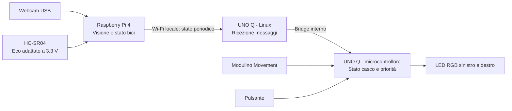

# MVP — assistenza al ciclista con modulo Bici e modulo Casco

Versione 0.1 — 10 ottobre 2026.

**Stato:** architettura richiesta dal team, con proposta operativa per l'MVP. Nessuna prestazione è ancora verificata sull'hardware. Le scelte indicate come proposte sono modificabili prima dell'implementazione.

## 1. Obiettivo

Dimostrare un sistema composto da due unità:

- **Bici:** osserva la scena posteriore, rileva la presenza di oggetti e ne riconosce la categoria. Trasmette lo stato al casco.
- **Casco:** mostra il feedback attraverso LED periferici e rileva localmente sequenze di movimento compatibili con una possibile caduta.

La dimostrazione avviene inizialmente indoor, con bici ferma, illuminazione controllata e un bersaglio alla volta. La fall detection è sperimentale: il risultato è un evento di **possibile caduta**, non la conferma di un incidente.

### Decisioni confermate dal team

| Elemento | Decisione |
|---|---|
| Elaborazione sulla bici | Raspberry Pi 4 Model B |
| Visione | Webcam Deltaco 2K QHD, codice esatto da verificare |
| Distanza | Disponibili un HC-SR04 e un Modulino Distance; preferenza per HC-SR04 |
| Elaborazione sul casco | Arduino UNO Q |
| Movimento del casco | Modulino Movement |
| Feedback | LED ai lati del campo visivo, nella vista periferica |
| Comunicazione | Il modulo Bici invia informazioni al modulo Casco |
| Criterio di rilevamento | Presente/non presente; nessuna stima dell'avvicinamento |

## 2. Confine decisivo: tre settori visivi, una zona di distanza

La webcam può distinguere **sinistra, centro e destra**, riferiti alla bici e al ciclista rivolto in avanti. Un solo HC-SR04 misura nel proprio cono e non fornisce tre distanze indipendenti. Nemmeno aggiungere il solo Modulino disponibile dà tre settori misurati.

**Proposta A per questo documento:** mantenere tre settori visivi e usare l'HC-SR04 centrale come informazione aggiuntiva di prossimità. Un oggetto laterale può quindi essere segnalato perché visto dalla webcam, ma non viene dichiarato entro una distanza misurata. Questa modifica del precedente requisito di attivazione tramite sensore richiede conferma del team.

**Alternativa B:** se ogni avviso deve necessariamente essere vincolato a una distanza misurata, limitare l'MVP alla zona centrale comune a webcam e HC-SR04. Sinistra/destra e la relativa segnalazione sono rinviate fino all'aggiunta di sensori.

Le sezioni successive descrivono la proposta A; con B rimangono invariati comunicazione e fall detection, mentre si riduce la copertura degli avvisi.

Non chiamare l'area un “raggio” uniforme: indicare nella demo il campo visivo della camera e, al suo interno, la zona misurata dal sensore. Misure senza eco o non valide producono **distanza sconosciuta**, non una garanzia di spazio libero.

## 3. Architettura proposta

Il Raspberry acquisisce webcam e distanza. Un modello preaddestrato leggero, eseguito localmente sulla CPU, fornisce categoria, riquadro e confidenza. Il modello concreto viene scelto attraverso la prima prova di prestazioni, mantenendo fisse le categorie dell'MVP. L'esempio App Lab precedentemente studiato per la UNO Q non va dato per installabile senza adattamenti sul Raspberry.

Sulla UNO Q, Linux riceve i messaggi via Wi-Fi e li inoltra tramite il Bridge interno al microcontrollore. Quest'ultimo legge il Modulino Movement, esegue la fall detection e decide il feedback. La connessione Wi-Fi non viene trattata come una funzione direttamente disponibile nello sketch senza il lato Linux/Bridge. [1][2]

La fall detection rimane operativa se il Raspberry, la webcam o il collegamento Wi-Fi si interrompono, purché il microcontrollore, l'IMU e l'alimentazione del casco funzionino.

## 4. Funzioni del modulo Bici

### Visione e categorie

- Acquisire video dalla Deltaco su una porta USB dati del Raspberry.
- Partire da una modalità supportata a risoluzione ridotta; elaborare immagini 2K non è un requisito.
- Riconoscere **persona, bicicletta, auto**. Mappare le etichette del modello su queste tre categorie.
- Usare **non identificato** per presenza misurata senza associazione visiva affidabile. Non interpretare l'assenza di una categoria come assenza fisica di qualsiasi ostacolo.
- Assegnare il settore dalla posizione del riquadro nell'immagine, dopo aver verificato orientamento, eventuale specchiatura e corrispondenza con i lati della bici.
- Usare una breve stabilizzazione temporale per evitare cambi di settore/colore dovuti a un singolo frame. Scartare risultati vecchi.

Per la demo iniziale entra un bersaglio alla volta. Se il modello produce più candidati incompatibili, segnalare ambiguità invece di scegliere arbitrariamente il più grande come oggetto più vicino. Una persona in sella può produrre i riquadri “persona” e “bicicletta”: il raggruppamento in “ciclista” non è un requisito iniziale. Provare prima persona a piedi e bicicletta senza conducente.

### Prossimità

HC-SR04 è il sensore principale proposto. Il modello classico dichiara 2 cm–4 m, ma la portata utile va misurata con bersagli e orientamento reali. Non trasferire automaticamente il massimo nominale nei requisiti della demo. [3]

| Parametro | Valore iniziale proposto, da tarare |
|---|---|
| Lettura HC-SR04 | Circa 10 Hz, senza sovrapporre le misure |
| Ingresso nello stato vicino | Distanza filtrata ≤80 cm |
| Uscita dallo stato vicino | Distanza filtrata ≥95 cm |
| Stabilizzazione | Filtro breve su tre letture valide; invalidi gestiti separatamente |
| Dato di distanza scaduto | Nessuna misura valida recente per 500 ms |

Un oggetto fermo entro soglia deve mantenere lo stato vicino. Non calcolare velocità relativa, tempo alla collisione o direzione del movimento.

Una misura HC-SR04 conclusa senza eco lascia la distanza sconosciuta: può dipendere dalla scena e non basta a diagnosticare un guasto o uno scollegamento. In questo caso la visione può continuare a indicare gli oggetti, senza pulsazione di prossimità. Distinguere questa condizione dall'assenza di aggiornamenti del processo di acquisizione o da un errore diagnosticato.

### Associazione fra distanza e immagine

Webcam e HC-SR04 sono fissati insieme. Si delimita nell'immagine la zona centrale effettivamente osservata dal sensore.

Una detection in quella regione non garantisce da sola che l'eco appartenga allo stesso oggetto. Per associare categoria e prossimità, la demo impone un unico bersaglio nella scena utile e verifica l'allineamento. In caso ambiguo:

- mantenere “ostacolo vicino, non identificato”;
- non attribuire la distanza a un'auto più lontana sullo sfondo;
- non trasferire la prossimità centrale a oggetti nei settori laterali.

Il Modulino Distance rimane una riserva per verifiche o sostituzione dell'HC-SR04. Il suo uso simultaneo e la fusione fra sensori non sono necessari per l'MVP.

## 5. Comunicazione Bici → Casco

**Proposta:** Wi-Fi locale e messaggi UDP contenenti lo stato completo, circa 5 volte al secondo e anche quando non è rilevato alcun oggetto. La ripetizione dello stato evita che la perdita di un singolo pacchetto lasci acceso un avviso indefinitamente. Non si trasmette il video al casco.

Entrambe le unità si collegano alla stessa rete locale con comunicazione fra client abilitata. Se la rete dell'evento isola i dispositivi, il Raspberry può creare un hotspot dedicato; i pacchetti e il modello devono essere già disponibili per funzionare senza Internet. [4]

| Informazione | Significato |
|---|---|
| Versione, identificativo sessione e sequenza | Validazione del formato, gestione di riavvii e pacchetti fuori ordine |
| Stato camera e stato sensore | Operativo, errore o dato scaduto |
| Stato visivo | Oggetto rilevato, nessun oggetto delle classi rilevato, ambiguo o non disponibile |
| Categoria e settore | Persona/bicicletta/auto/non identificato; sx/centro/dx/sconosciuto |
| Prossimità centrale | Vicino, oltre soglia o sconosciuta; eventuale distanza in cm |
| Qualità dell'associazione | Associazione ammessa nella scena controllata oppure non disponibile/ambigua |
| Età dei dati alla trasmissione | Età di immagine e distanza calcolata sul Raspberry |

L'HC-SR04 non misura la distanza degli oggetti laterali: il messaggio mantiene separati stato visivo e prossimità centrale.

Il ricevitore accetta pacchetti del dispositivo configurato, valida i campi e scarta duplicati/riordinamenti nella sessione. Conserva lo stato più recente senza accumulare una coda. Il timeout usa il tempo locale di ricezione: non confrontare timestamp assoluti di schede senza sincronizzazione. L'età dichiarata dal mittente non include eventuali ritardi di rete, da misurare nelle prove.

**Timeout proposto: 1 secondo senza nuovo stato valido.** Il casco elimina la vecchia indicazione di oggetto e mostra “collegamento non disponibile”. Alla scadenza, Linux inoltra subito lo stato scaduto al microcontrollore. Quest'ultimo mantiene anche un timeout sugli aggiornamenti ricevuti dal lato Linux, così da rilevare un blocco del processo ricevente/Bridge. Inoltrare soltanto nuovi stati ricevuti o variazioni di stato diagnostico, senza rinnovare continuamente la validità di un vecchio pacchetto. Nuovi heartbeat non rendono fresca una vecchia detection: oltre 1 secondo dall'ultima elaborazione video valida, lo stato visivo è non disponibile.

Nessun server cloud, broker o smartphone obbligatorio nel percorso degli avvisi. La trasmissione di eventi di caduta verso la bici non è richiesta nell'MVP.

## 6. Feedback sul casco

**Proposta:** due indicatori RGB indipendenti, uno sinistro e uno destro. Con due LED, il settore centrale si rappresenta accendendoli entrambi. Questa convenzione è non ambigua nella demo con un solo bersaglio; non rappresenta due oggetti simultanei a sx e dx.

| Evento | Indicazione proposta |
|---|---|
| Persona | Blu sul lato corrispondente |
| Bicicletta | Magenta sul lato corrispondente |
| Auto | Ambra sul lato corrispondente |
| Oggetto visivo centrale | Entrambi i LED nel colore della categoria |
| Prossimità centrale associata al bersaglio | Colore della categoria con pulsazione lenta |
| Ostacolo vicino non identificato / scena ambigua | Entrambi bianchi con pulsazione lenta; nessuna direzione dedotta |
| Nessuna detection, sistema operativo | Nessun avviso oggetto; breve segnale periodico di stato a bassa luminosità |
| Collegamento perso o errore diagnosticato di camera/acquisizione distanza | Pattern di stato ciano distinto; log specifica il componente indisponibile |
| Possibile caduta rilevata | Entrambi rossi con pattern distinto, mantenuto fino ad annullamento |
| IMU non disponibile | Pattern di guasto distinto; fall detection non armabile |

Colori e pattern sono una proposta di interfaccia, da provare per distinguibilità e comfort. Priorità del controllo: **caduta già segnalata → guasto IMU → stato degradato → oggetto → stato operativo**. Nel primo MVP uno stato degradato prevale sull'indicazione oggetto per evitare combinazioni difficili da interpretare.

La sola assenza di eco dell'HC-SR04 non attiva il pattern di guasto: la distanza resta sconosciuta e gli oggetti riconosciuti visivamente possono essere segnalati a colore fisso. Una nuova misura valida entro soglia riabilita l'indicazione di prossimità.

La destra/sinistra indica sempre il lato della bici; ruotare la testa non rimappa automaticamente i LED. Il Modulino Movement non misura l'orientamento della bici e non basta a ricostruire stabilmente l'angolo relativo casco–bici. La rimappatura rispetto allo sguardo è fuori scope.

Usare luminosità regolabile, diffusione e montaggio rimovibile ai margini della vista, senza occludere la visione o puntare LED intensi direttamente negli occhi. Il casco non deve essere forato per la demo.

## 7. Fall detection sul casco

Modulino Movement integra un LSM6DSOXTR a sei assi: accelerometro e giroscopio, senza magnetometro. Consente di sperimentare rilevamento di urti, rotazioni e cambi d'inclinazione. Non garantisce da solo il riconoscimento delle cadute. [5]

**Algoritmo MVP proposto:** macchina a stati, eseguita sul microcontrollore della UNO Q.

1. **Disarmato/calibrazione:** avvio, verifica IMU, stima del riferimento con casco fermo per alcuni secondi.
2. **Armato:** lettura continua, proposta circa 100 Hz. Mantenere una breve storia delle misure e verificare che il campo di misura non saturi negli eventi di prova.
3. **Evento candidato:** picco di accelerazione oltre soglia.
4. **Cambio d'inclinazione:** entro una finestra breve, verificare una variazione rispetto alla postura precedente all'evento.
5. **Quiete successiva:** verificare bassa rotazione e accelerazione compatibile con la gravità per un periodo continuo.
6. **Possibile caduta:** attivare il feedback rosso e registrare il motivo dell'evento. Se la sequenza non si completa nei tempi previsti, tornare armato.

| Parametro | Punto di partenza sperimentale, non validato |
|---|---|
| Picco della norma di accelerazione | >2,5 g, gravità inclusa |
| Variazione d'inclinazione | >45° rispetto al riferimento pre-evento |
| Finestra urto → variazione | Entro 2 s |
| Quiete | Norma del giroscopio <10°/s e norma accelerazione entro 1 g ±0,15 g |
| Durata quiete continua | 3 s, da completare entro 5 s dalla variazione |
| IMU scaduta | Nessun campione valido per 300 ms: stato di guasto |

Le soglie devono essere tarate con dati registrati. Una sequenza che non presenta urto o quiete può non essere riconosciuta; un casco tolto o appoggiato bruscamente può generare un falso positivo. L'algoritmo non stabilisce se il casco è indossato.

**Pulsante proposto:** pressione lunga per armare/disarmare esplicitamente; pressione breve per annullare un evento di caduta, tornando disarmato. Un evento non sparisce soltanto perché arriva un avviso dalla bici o si interrompe la rete.

### Serve il Kalman?

Non è un requisito dell'MVP. Per la stima di inclinazione si può usare un filtro complementare fra accelerometro e giroscopio, riducendo il contributo dell'accelerometro durante accelerazioni dinamiche. Un'inclinazione calcolata dal solo accelerometro durante un urto sarebbe poco attendibile.

L'EKF del documento originale non va trasferito integralmente: lì si fondono anche dati magnetici, mentre qui non si richiede un orientamento assoluto della testa. Un Kalman potrà essere valutato se dati e prove mostrano un vantaggio concreto.

## 8. Hardware e BOM preliminare

| Componente | Quantità | Ruolo / stato |
|---|---:|---|
| Raspberry Pi 4 Model B | 1 | Unità Bici; RAM e stato dell'OS da verificare |
| microSD con Raspberry Pi OS | 1 | Avvio, software e modello; presenza da confermare |
| Deltaco 2K QHD | 1 | Webcam USB; codice e acquisizione Linux da verificare |
| HC-SR04 | 1 | Distanza centrale; sensore principale proposto |
| Partitore resistivo / adattamento Echo | 1 circuito | Obbligatorio per Echo a 5 V verso GPIO del Pi a 3,3 V |
| Arduino UNO Q | 1 | Unità Casco |
| Modulino Movement | 1 | IMU del casco |
| Cavo Qwiic | 1 | Collegamento IMU–UNO Q; verificare lunghezza |
| Indicatori RGB indipendenti | 2 | Sinistra/destra; modello da confermare |
| Resistenze/driver/adattatore livelli LED | Secondo il modulo | Definire dopo identificazione dei LED; non alimentare carichi elevati dai GPIO |
| Pulsante tattile | 1 | Armamento e annullamento caduta; proposta |
| Alimentazione USB-C per Pi 4 | 1 | Sorgente adeguata a 5 V / 3 A e periferiche [6] |
| Alimentazione USB-C per UNO Q | 1 | Sorgente adeguata a 5 V / 3 A e periferiche [1] |
| Cavi, supporti, isolamento, diffusori LED | 1 set | Montaggio rimovibile e protezione dei cablaggi |
| Modulino Distance | 1 disponibile | Riserva, non necessario nella configurazione principale |

Per il Raspberry, Echo dell'HC-SR04 classico non si collega direttamente al GPIO a 3,3 V: usare un partitore dimensionato o un adattatore. Verificare variante, massa comune e distinzione tra numerazione GPIO e pin fisici prima del cablaggio. La documentazione GPIO Zero illustra questo collegamento. [7]

La webcam può collegarsi direttamente alle porte USB-A del Pi 4: l'hub USB-C richiesto dalla vecchia architettura webcam–UNO Q non è un requisito di questa configurazione. Un hub alimentato può servire solo se le prove evidenziano limiti di alimentazione delle periferiche. [8]

Per la prima demo usare alimentatori da banco/USB. Per una dimostrazione indossata, confermare due alimentazioni portatili adeguate e il fissaggio; non assumere che la LiPo disponibile alimenti direttamente una delle due schede. Autonomia e peso non sono ancora misurati.

## 9. Criteri di accettazione proposti

Tutti i risultati vanno registrati con configurazione, illuminazione, distanze e versione del software. Le percentuali sotto sono criteri della demo, non una stima di affidabilità stradale.

| Area | Prova | Obiettivo MVP |
|---|---|---|
| Webcam e Pi | Video e inferenza continuativi | 5 minuti senza blocchi o riavvii |
| Classi e settori visivi | 10 presentazioni per categoria realmente testabile, distribuite nei tre settori | Almeno 9/10 indicazioni corrette per categoria, con tempi annotati |
| Latenza visiva | Ingresso bersaglio → colore corretto sul casco | Obiettivo ≤1 s nelle prove controllate |
| Distanza | Oggetto a 60 cm e a 110 cm nel cono, 10 alternanze | Presenza/uscita corrette; niente oscillazione continua con oggetto fermo |
| Associazione | Ostacolo vicino e altro oggetto riconoscibile sullo sfondo | Nessuna attribuzione automatica della distanza all'oggetto lontano |
| Comunicazione | Stato inviato → aggiornamento LED, misurato separatamente dalla visione | Obiettivo ≤200 ms sulla rete della demo |
| Perdita rete o processo ricevente | Interrompere Wi-Fi/processo | Vecchio avviso rimosso e stato degradato entro 1,5 s |
| Ripristino | Ripetere tre interruzioni e ripristini | Ripresa automatica con dati nuovi, senza vecchi avvisi |
| Caduta, logica | Riprodurre cinque tracce annotate che soddisfano la sequenza proposta | Cinque eventi; annullamento e riarmo funzionanti |
| Caduta, controlli negativi | Rotazioni della testa, piegamenti e movimenti normali controllati | Nessun evento nei casi di prova; annotare eventuali falsi positivi |
| Indipendenza | Interrompere collegamento Bici durante una traccia di caduta | La fall detection locale continua e mantiene priorità |
| Guasti sensori | Scollegare webcam, distanza o IMU | Camera/IMU non disponibili; HC-SR04 senza eco produce distanza sconosciuta, senza pretendere di distinguere scollegamento e assenza di eco della scena |

Per la fall detection usare un supporto imbottito o tracce IMU riprodotte: non provocare cadute di persone né colpire un casco indossato. Le tracce sintetiche verificano la logica, non la capacità di riconoscere incidenti reali. Distinguere nel verbale test con IMU fisica, replay e dati sintetici.

## 10. Sequenza di realizzazione e demo

1. **Portare in funzione l'hardware:** video Deltaco sul Pi, distanza HC-SR04, letture Movement e due colori LED sulla UNO Q.
2. **Verificare il collegamento:** inviare stati di prova dal Pi, inclusi nessun oggetto e guasto; verificare timeout fino al microcontrollore.
3. **Integrare la visione:** scegliere il modello che soddisfa le prove sul Pi 4, mappare categorie e settori, mostrare i risultati sul casco.
4. **Integrare la prossimità:** tarare cono e soglie; provare esplicitamente il caso ambiguo dello sfondo.
5. **Integrare la fall detection:** registrare movimenti, tarare le soglie, verificare armamento, annullamento e priorità.
6. **Dimostrazione finale:** bersaglio visivo → LED; ostacolo centrale vicino → feedback di prossimità; perdita rete → stato degradato; sequenza IMU dichiarata di prova → possibile caduta.

Se il Pi 4 non raggiunge i tempi della demo, ridurre risoluzione o scegliere un modello più leggero e ripetere le misure. Spostare l'inferenza sul computer sarebbe un fallback dimostrativo da dichiarare, non il completamento dell'MVP autonomo richiesto.

## 11. Esclusioni e decisioni da chiudere

Fuori scope: avvicinamento e velocità, distanza per tutti e tre i settori con un unico sensore, compensazione dello sguardo, più oggetti rappresentati contemporaneamente sui due LED, SOS/chiamate/GPS, cloud, addestramento di un nuovo modello, autonomia garantita e validazione stradale.

Prima del cablaggio e dell'implementazione confermare:

1. **Copertura:** proposta A (tre settori visivi e distanza centrale) oppure B (sola prossimità centrale). È una scelta di comportamento, non risolvibile con una configurazione software del solo HC-SR04.
2. **Componenti esatti:** webcam, variante HC-SR04, indicatori RGB, alimentazioni e microSD.
3. **Interfaccia:** due LED, colori/pattern e pulsante di armamento/annullamento proposti.
4. **Condizioni della demo:** rete disponibile, bersagli realmente testabili e tempo residuo.

## 12. Relazione con i documenti precedenti e fonti

Questo è il riferimento per il nuovo MVP Bici + Casco. `SCOPE.md` e `FATTIBILITA-BICI.md` conservano le precedenti architetture. `VERIFICA-WEBCAM-UNO-Q.md` riguarda il vecchio collegamento: i controlli USB/V4L2 restano utili su Linux, ma host, alimentazione e prova App Lab non vanno applicati direttamente al Raspberry.

Fonti tecniche consultate; soglie, protocollo, colori e criteri di accettazione sono proposte del progetto, non prestazioni dichiarate dai produttori.

1. [Arduino UNO Q — manuale, alimentazione e Bridge](https://docs.arduino.cc/tutorials/uno-q/user-manual/).
2. [Arduino UNO Q — architettura Linux e microcontrollore](https://docs.arduino.cc/tutorials/uno-q/debian-guide/).
3. [HC-SR04 classico — specifiche](https://www.sparkfun.com/ultrasonic-distance-sensor-hc-sr04.html).
4. [Raspberry Pi OS — rete e hotspot](https://www.raspberrypi.com/documentation/computers/configuration.html).
5. [Arduino Modulino Movement — sensore a sei assi](https://docs.arduino.cc/hardware/modulino-movement/).
6. [Raspberry Pi — alimentazioni raccomandate](https://www.raspberrypi.com/documentation/computers/getting-started.html).
7. [GPIO Zero — collegamento sensore di distanza e partitore Echo](https://gpiozero.readthedocs.io/en/stable/recipes.html#distance-sensor).
8. [Raspberry Pi — GPIO e porte USB](https://www.raspberrypi.com/documentation/computers/raspberry-pi.html).
